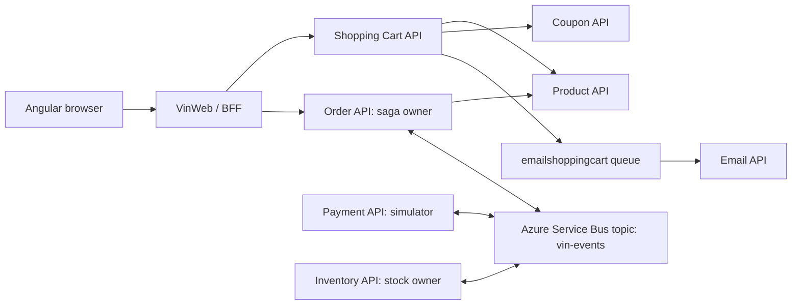
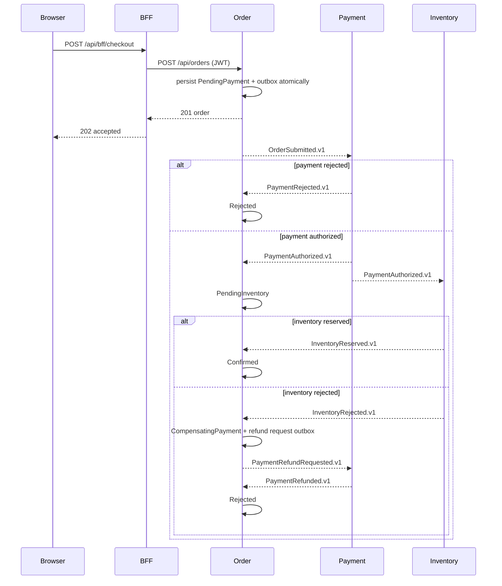

# Vin Shop architecture lab

This repository is intentionally a learning system. It favors visible ownership and recoverable distributed workflow over a deceptively simple single-database checkout.

## Service ownership

| Service | Owns | May call synchronously | Consumes / publishes |
| --- | --- | --- | --- |
| Auth | identities, roles, JWTs | none | JWT for all protected APIs |
| Product | product catalogue and current prices | none | queried by Cart and Order |
| Coupon | promotion rules | none | queried by Cart |
| Shopping Cart | a user's mutable cart | Product, Coupon | publishes email-cart queue message |
| Order | order record and saga state | Product (price snapshot only) | publishes/consumes `vin-events` |
| Payment | simulated payment transaction | none | consumes order/refund events; publishes authorization/rejection/refund events |
| Inventory | stock and reservations | none | consumes payment authorization; publishes reservation result |
| Email | notification log | none | consumes email-cart queue |

No service reads or writes another service's SQL database. `Vin.Contracts` carries versioned, data-only integration events; it does not contain domain services or repositories.

## Checkout consistency model

Checkout is eventually consistent. BFF returns `202 Accepted` as soon as Order commits both its order record and an outbox entry. The browser then polls the Order endpoint to observe the saga state.

## Delivery guarantees and recovery

- The delivery contract is **at-least-once**, not exactly-once.
- Every publisher records its envelope in a transactional outbox in its own database. `OutboxPublisher` retries publish and marks a message locally dead-lettered after 10 failed attempts.
- Consumers write an inbox row keyed by `EventId` in the same database transaction as their workflow update. A duplicate event is completed without re-running business logic.
- The Service Bus emulator subscriptions use a delivery limit of 5. A deserialization error is explicitly dead-lettered; unhandled processing errors are retried by Service Bus.
- The Order API is the only component allowed to transition the public order saga state. Payment and Inventory own only their local transaction/reservation state.

## Local failure injection

| Scenario | How to demonstrate | Expected observation |
| --- | --- | --- |
| Payment rejection | Set `PAYMENT_REJECT_EVERY_NTH_ORDER=1` in `.env`, recreate Payment container, then checkout. | `PendingPayment` becomes `Rejected`. |
| Inventory rejection | Leave a product without configured stock, or set its stock to `0` through the Inventory API as an admin. | Payment authorizes; Order shows `CompensatingPayment`, then `Rejected` after refund. |
| Duplicate delivery | Re-send a captured envelope with the same `eventId`. | Consumer logs an ignored duplicate; no second stock change. |
| Broker unavailable | Stop `servicebus-emulator` after Order accepts checkout. | Outbox remains pending/retries; restoring the broker lets the flow continue. |
| Consumer poison payload | Publish invalid JSON to a subscription. | The processor dead-letters it; inspect the emulator/Service Bus tooling. |

## Health, correlation, and telemetry

- All BFF/API processes expose `/health/live`, `/health/ready`, and legacy `/health`. Readiness verifies its own database where applicable.
- `X-Correlation-ID` is accepted from a request, generated when absent, returned in the response, propagated on outgoing HTTP calls, stored in integration envelopes, and included in logging scopes.
- `Vin.Shop` is the built-in `ActivitySource` and `Meter` name. Request count and duration instruments are emitted without coupling application code to a vendor. Attach an OpenTelemetry/OTLP exporter in the host environment when a collector is chosen.
- BFF and Cart use an explicit 8-second timeout, bounded retry for safe HTTP methods, and a 20-second circuit breaker after repeated downstream failures.

## Running the lab

1. Copy `.env.example` to `.env` only if you need overrides.
2. Start Docker Desktop, then run `docker compose up --build`.
3. Open `http://localhost:8080`; Swagger is available on each API port.
4. Seed inventory with an admin token using `PUT http://localhost:8088/api/inventory/items/{productId}` and `{ "availableQuantity": 20 }`.
5. Add a product to the cart and choose **Place learning order**. The order tracker shows the saga in motion.

The Service Bus emulator is development/test-only. Its entities are declared in `infra/servicebus/Config.json`; changing them requires recreating the emulator container. Microsoft documents the emulator's Docker configuration, health endpoint, and local connection-string variants in its [official guide](https://learn.microsoft.com/en-us/azure/service-bus-messaging/test-locally-with-service-bus-emulator).
